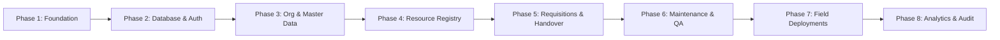

# Ethiopian Engineering Corporation (EEC)
## Resource Management System (RMS) — Comprehensive Analysis & Implementation Roadmap

> **Document Status:** Baseline Architecture & Strategic Roadmap  
> **Author:** Gemini (Advanced Agentic Architecture Analysis)  
> **Target System:** EEC Resource Management System (RMS)  
> **Target Stack:** React 18 + Vite + TypeScript + Tailwind CSS (SPA) | Node.js + Express + TypeScript + Prisma ORM + PostgreSQL  

---

## 1. Executive Summary & Context

The Ethiopian Engineering Corporation (EEC) is a major public enterprise delivering landmark civil infrastructure, water resource engineering, transport, energy, and geotechnical projects nationwide. 

The initial **Enterprise Asset Management System (EAMS)** established solid foundations for organizational hierarchy, multi-tiered role-based access control (RBAC), approval workflows, custody handovers, and maintenance state machines. However, it was primarily scoped to corporate IT assets (laptops, desktops, servers). 

In reality, EEC's most critical capital and operational resources are deployed in the field across diverse project sites:
1. **Transport & Fleet Vehicles** (pickups, staff buses, haulage trucks)
2. **Heavy Construction Machinery & Plant** (excavators, bulldozers, wheel loaders, graders)
3. **Geotechnical, Surveying & Metrology Equipment** (total stations, RTK GNSS, soil test apparatus)
4. **Site Camp & Utility Infrastructure** (heavy generators, industrial pumps, temporary facilities)
5. **IT & Office Technology** (workstations, plotters, servers, network infrastructure)

The new **EEC Resource Management System (RMS)** consolidates and expands these assets into a unified enterprise platform, replacing manual paper processes, preventing custodial disputes, and optimizing asset utilization.

---

## 2. Key Findings & Lessons Learned from Original Handover

Analysis of the 8 handover documents highlights critical design patterns and architectural imperatives:

1. **Hydration and Routing Stability (SPA vs SSR):**
   - The Next.js 14 App Router in the previous iteration suffered from complex hydration sync, route interceptor mismatches, and SSR boundary friction.
   - **Decision:** RMS adopts a clean, pure Client-Side Single Page Application (React + Vite + React Router v6) to deliver instant client navigation, reliable state guards, and predictable lifecycle behavior.

2. **Backend Architecture & Atomic State Machines:**
   - The existing transactional workflow pattern (Prisma `$transaction` with strict status guards) was proven and robust.
   - **Decision:** Retain the layered Express + TypeScript + Prisma architecture. Ensure all inventory counts, custody handovers, and status transitions remain strictly derived from atomic database transactions.

3. **RBAC & Authorization:**
   - Single source of truth for user role is `User.role` backed by an active `EmployeeProfile`.
   - Core roles: `ADMIN`, `STORE_KEEPER`, `DEPARTMENT_MANAGER`, `IT_TECHNICIAN` (generalized to `MAINTENANCE_ENGINEER`), and `EMPLOYEE`.

4. **Brand & Visual Language:**
   - Strictly adhere to approved EEC corporate design tokens:
     - **Primary Teal:** `#083D4A` (commanding headers, primary buttons, sidebar)
     - **Accent Cyan:** `#00A7D6` (focus rings, interactive accents, link states)
     - **Terracotta Alert:** `#C96F59` (active indicators, urgent warnings, highlight accents)
     - **Background Canvas:** `#F4F8FA` (subtle cool grey/cyan background for high legibility)
     - **Surface Card:** `#FFFFFF` (crisp white cards with refined borders)

---

## 3. RMS Architecture & Taxonomy

### 3.1 Two-Tier Resource Taxonomy
To accommodate vastly diverse resource classes without polluting the schema with null fields, the RMS employs a two-tier classification:
- **Base `Resource` Model:** Common tracking fields (`resourceCode`, `name`, `category`, `status`, `condition`, `departmentId`, `purchaseDate`, `purchaseCost`, `currentLocation`).
- **Category Extension Schemas / JSONB Attributes:**
  - **Vehicles:** Plate number, chassis/VIN, engine number, fuel type, mileage (km), insurance expiry, annual inspection expiry, assigned driver.
  - **Heavy Plant:** Machine serial, operating hours (SMU), engine power (kW/HP), service interval (hours), site assignment, certified operator.
  - **Surveying & Lab:** Calibration certificate, calibration date, calibration expiry date, measurement accuracy, bundled accessories checklist.
  - **Site Infrastructure:** Power rating (kVA), fuel consumption rate, phase configuration, installation location.
  - **IT & Office Equipment:** Serial number, specifications (CPU/RAM/storage), OS license, MAC address.

### 3.2 Dual Custody Models: Individual Staff & Project Sites
- **Staff Custody:** Resources assigned directly to a named employee via signed handover voucher.
- **Project Site Deployment:** Heavy plant and shared field gear deployed to a project location under the custodial oversight of the **Resident Project Engineer** or **Site Supervisor**.

---

## 4. Phased Implementation Roadmap

### Phase 1: Foundation & Scaffold (Current Phase)
- **Objective:** Establish monorepo structure, independent package management, root scripts, Prisma baseline, Express health check, and EEC-branded Vite SPA.
- **Deliverables:**
  - `frontend/`: React + Vite + TypeScript + Tailwind CSS + React Router.
  - `backend/`: Node.js + Express + TypeScript + Prisma config.
  - `docs/handover/`: 8 original handover documents preserved.
  - Root orchestration: `package.json`, `.gitignore`, `.env.example`, `README.md`.
  - CORS & Axios credentials verification.
  - Type-checks and production builds passing with zero errors.

### Phase 2: Database Schema & Authentication Core
- **Objective:** Establish PostgreSQL schema with Prisma, implement session/JWT auth, registration, approval gates, and seed EEC master data.
- **Deliverables:**
  - Prisma schema with `User`, `Account`, `Session`, `EmployeeProfile`, `Department`.
  - Auth controllers: login, register, logout, current session (`/api/auth/me`).
  - Pending approval state for new accounts.
  - Database seed script with verified EEC departments and administrative users.

### Phase 3: Organizational Master Data & User Management
- **Objective:** Management interfaces for EEC departments, employees, and user account approvals.
- **Deliverables:**
  - Department catalog and structural hierarchy.
  - Employee roster with designation, phone, and role synchronization.
  - Administrator user approval queue.

### Phase 4: Multi-Category Resource Registry & Inventory
- **Objective:** Complete resource catalog with category-specific attributes and dynamic status derivation.
- **Deliverables:**
  - Resource listing with multi-attribute filtering (category, status, condition, department).
  - Dynamic inventory metric counters (Available, Assigned, In Maintenance, In Testing, Retired).
  - Resource registration and barcode/QR tag generator.

### Phase 5: Requisitions, Approvals & Custody Handover
- **Objective:** End-to-end requisition and physical asset issuance workflow.
- **Deliverables:**
  - Employee resource requisition form.
  - Department manager & Admin approval queues with comment trails.
  - Storekeeper handover modal: serial selection, condition recording, digital acknowledgement voucher.

### Phase 6: Maintenance, Inspection & Calibration Lifecycle
- **Objective:** Track work orders, periodic servicing, and testing gates.
- **Deliverables:**
  - Maintenance ticket ticketing system with technician assignment.
  - Hour-meter and mileage tracking triggers.
  - Calibration validity tracking for surveying equipment (blocking checkout if expired).
  - Mandatory inspection & QA gate before returning resources to active store inventory.

### Phase 7: Project Site Deployments & Asset Transfers
- **Objective:** Field logistics for heavy machinery and site equipment.
- **Deliverables:**
  - Project site registry (project name, location, project manager).
  - Site deployment vouchers and inter-project transfers.
  - Asset return workflow with return inspection checklist.

### Phase 8: Reporting, Analytics & Audit Trail
- **Objective:** Executive dashboards, inventory audits, and exportable compliance reports.
- **Deliverables:**
  - Departmental asset allocation breakdown.
  - Resource depreciation and maintenance cost summaries.
  - PDF/Excel export for internal audit and government compliance.

---

## 5. Non-Negotiable Engineering Standards

1. **Explicit TypeScript Typings:** Avoid `any`; use strictly typed interfaces across frontend services and backend controllers.
2. **Atomic Financial & Custody Integrity:** Never perform multi-step inventory adjustments without database transaction isolation (`prisma.$transaction`).
3. **Defense in Depth RBAC:** Enforce permissions at the API router level, controller service level, and UI navigation level.
4. **Resilient Network Handling:** Frontend API client pre-configured with `withCredentials: true`, timeout handling, and centralized error interceptors.
5. **Accessibility & Design Consistency:** Consistent button states, focus rings, accessible contrast against `#F4F8FA`, and responsive layout shells.
