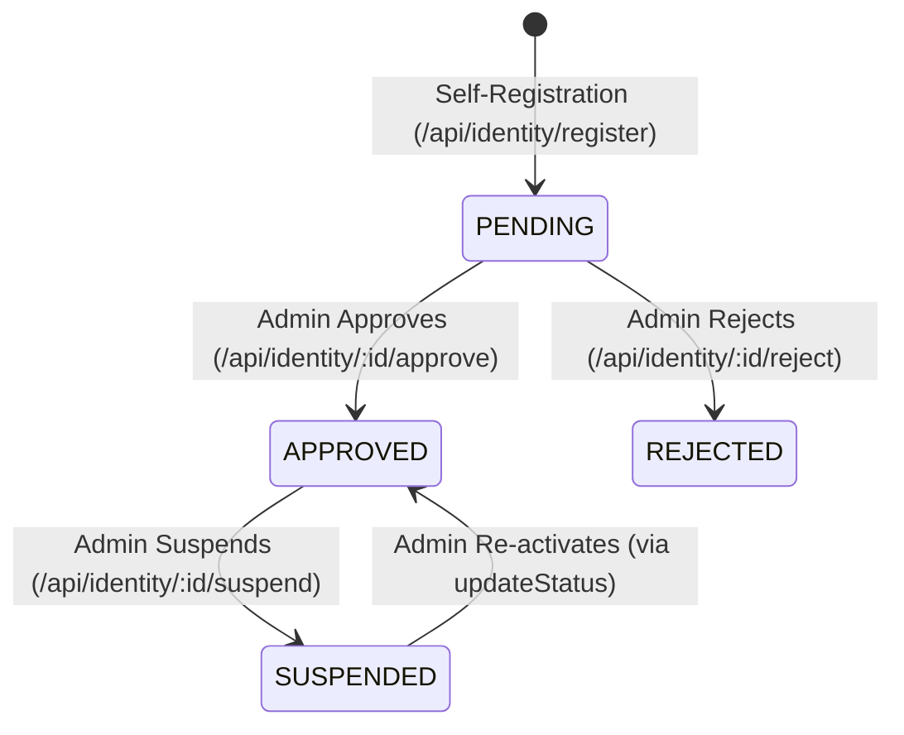

# 02. Roles and Permissions Matrix

## 1. System Roles Overview

The original system implements **5 distinct roles** defined in `backend/src/constants/roles.ts` and mirrored in Prisma enum `UserRole`:

```typescript
export const ROLES = {
  ADMIN: 'ADMIN',
  IT_TECHNICIAN: 'IT_TECHNICIAN',
  DEPARTMENT_MANAGER: 'DEPARTMENT_MANAGER',
  EMPLOYEE: 'EMPLOYEE',
  STORE_KEEPER: 'STORE_KEEPER',
} as const;
```

Each authenticated account has exactly **one primary role** assigned on the `User` model, which governs both frontend route visibility and backend endpoint authorization.

---

## 2. Comprehensive Role Capabilities & Boundaries

### 2.1 ADMIN (System Administrator / ICT Directorate)
- **Primary Responsibility**: Global governance, account approvals, organizational master data, and requisition approvals.
- **Scope**: Enterprise-wide (no department boundary restrictions).
- **What they CAN do**:
  - Review, approve (with role designation), or reject self-registered user accounts (`/api/identity/pending`, `/api/identity/:id/approve`, `/api/identity/:id/reject`).
  - Suspend or reactivate user accounts.
  - Create, update, and soft-deactivate corporate departments (`/api/departments`).
  - Create, edit, and deactivate employee profiles (`/api/employees`).
  - Create, edit, update status, and manage physical location of all assets (`/api/assets`).
  - Direct assign, transfer, and return assets via IT assignment module (`/api/assignments`).
  - Approve or reject asset requests submitted by staff or managers (`/api/requests/:id/approve`, `/api/requests/:id/reject`).
  - Fulfill asset requests or receive asset returns (backup for Store Keeper).
  - Create and manage maintenance tickets; view and conduct inspections.
  - Access executive KPI reports (assets, employees, departments, maintenance, warranties).
  - Update centralized corporate system settings, branding, and contact details (`/api/settings`).
- **What they CANNOT do**:
  - Delete records permanently when soft-delete or active flags are enforced (e.g. inactive departments remain linked to historical asset records).

---

### 2.2 IT_TECHNICIAN (ICT Support & Hardware Specialist)
- **Primary Responsibility**: Asset technical cataloging, direct assignment, maintenance operations, and QA testing.
- **Scope**: Enterprise technical assets and maintenance (bypasses department restrictions for hardware and tickets).
- **What they CAN do**:
  - View all departments, staff profiles, and asset records across the corporation.
  - Register new assets and update asset specifications, serial numbers, and condition ratings.
  - Perform direct asset assignments, transfers between employees, and returns (`/api/assignments`).
  - View, create, and update maintenance tickets (`/api/maintenance`).
  - Receive assigned tickets, update ticket progress, add resolution notes, and log repair costs.
  - Conduct quality inspections and record test results (`/api/testing`).
  - View enterprise inventory metrics and maintenance reports.
  - Request assets for personal use via `/my-requests`.
- **What they CANNOT do**:
  - Approve or reject user registration requests (Admin only).
  - Approve or reject formal asset requests (Admin only).
  - Create or edit department master data or employee HR records.
  - Modify system settings or corporate branding.

---

### 2.3 DEPARTMENT_MANAGER (Directorate / Sector Head)
- **Primary Responsibility**: Departmental asset oversight, staff asset monitoring, and requisition initiation.
- **Scope**: **Strictly scoped to their assigned department** (`user.employeeProfile.departmentId`).
- **What they CAN do**:
  - View details of their own department.
  - View profiles of employees belonging to their department.
  - View assets currently assigned to employees within their department.
  - View maintenance tickets concerning assets belonging to their department.
  - Submit asset requests on behalf of their department or themselves.
  - Submit asset return requests for assets assigned within their department.
  - View departmental asset distribution and allocation reports (`/api/reports/departments`).
  - Cancel pending asset requests created by themselves.
- **What they CANNOT do**:
  - View or query employees or assets belonging to other departments (enforced via `requireDepartmentAccess` returning `403 Forbidden`).
  - Formally approve asset requests (Approval is strictly retained by Corporate Admin to prevent unauthorized procurement).
  - Execute physical asset handovers or direct asset assignments.
  - Register new hardware into the enterprise asset catalog.
  - Create or edit departments or modify system settings.

---

### 2.4 EMPLOYEE (Corporate Staff Member)
- **Primary Responsibility**: Individual custodial responsibility for assigned working equipment.
- **Scope**: **Strictly personal resources** (`employee.userId === auth.userId`).
- **What they CAN do**:
  - Access personal portal pages: `/my-assets`, `/my-requests`, `/my-maintenance`.
  - View assets currently assigned to them and view assignment condition notes.
  - Submit new asset requisitions (`/api/requests`) specifying equipment category and justification.
  - Cancel their own pending requisitions before admin approval.
  - Submit a return request (`/api/returns`) when equipment is no longer required or requires replacement.
  - Report maintenance issues on assets currently assigned to them (`/api/maintenance`).
  - Receive in-app notifications regarding account approvals, equipment assignments, and repair status.
- **What they CANNOT do**:
  - Access the general enterprise asset catalog (`/assets`), inventory, or store operations.
  - View other staff profiles, other departments' assets, or corporate reports.
  - Assign, transfer, or complete returns without Store Keeper or IT Technician intervention.
  - Conduct inspections or approve requests.

---

### 2.5 STORE_KEEPER (Warehouse & Physical Custody Custodian)
- **Primary Responsibility**: Physical warehouse storage, custody tracking, physical handover of approved equipment, and processing asset returns.
- **Scope**: Store operations, inventory levels, and physical equipment custody.
- **What they CAN do**:
  - Access the dedicated **Store Operations Hub** (`/store`).
  - Monitor enterprise inventory totals, status breakdown, and storage locations (`/store/inventory`, `/api/assets/inventory`).
  - Update physical warehouse locations for assets (`PATCH /api/assets/:id/location`).
  - View all approved asset requests awaiting physical handover (`/store/requests`).
  - **Fulfill asset requests** (`POST /api/requests/:id/fulfill`): Inspect available warehouse stock matching the requested category, select a physical serial number, record handover condition notes, and execute atomic assignment to the employee.
  - Process asset returns (`/store/returns`):
    - **Path A**: Receive scheduled return requests (`POST /api/returns/:id/receive`), record return condition and return warehouse location, close assignment, and restore asset status to `AVAILABLE`.
    - **Path B**: Direct walk-in returns (`POST /api/returns/walk-in`) without a prior request.
  - View chronological asset movement history (`/api/store/assets/:assetId/movement-history`).
- **What they CANNOT do**:
  - Formally approve or reject asset requests (Approval is strictly Admin; Store Keeper handles physical fulfillment).
  - Approve user registrations or modify employee/department master data.
  - Conduct technical QA inspections or close technical maintenance tickets.
  - Alter system settings or access executive financial/warranty reports.

---

## 3. Granular Permissions Mapping (Backend RBAC)

The backend defines 28 granular permissions in `backend/src/constants/permissions.ts`. The exact mapping enforced by `requirePermission` is documented below:

| Permission Identifier | Description | ADMIN | IT_TECHNICIAN | DEPARTMENT_MANAGER | EMPLOYEE | STORE_KEEPER |
| :--- | :--- | :---: | :---: | :---: | :---: | :---: |
| `departments:view` | View department records | ✅ | ✅ | ✅ | ❌ | ✅ |
| `departments:create` | Create new department | ✅ | ❌ | ❌ | ❌ | ❌ |
| `departments:update` | Edit department details | ✅ | ❌ | ❌ | ❌ | ❌ |
| `employees:view` | View employee rosters | ✅ | ✅ | ✅ | ❌ | ❌ |
| `employees:create` | Create employee profile | ✅ | ❌ | ❌ | ❌ | ❌ |
| `employees:update` | Update employee profile | ✅ | ❌ | ❌ | ❌ | ❌ |
| `assets:view` | View asset records | ✅ | ✅ | ✅ (Dept only) | ✅ (Self only) | ✅ |
| `assets:create` | Register new asset | ✅ | ✅ | ❌ | ❌ | ❌ |
| `assets:update` | Edit asset details | ✅ | ✅ | ❌ | ❌ | ❌ |
| `assets:assign` | Direct assign/transfer asset | ✅ | ✅ | ❌ | ❌ | ❌ |
| `maintenance:view` | View maintenance tickets | ✅ | ✅ | ✅ (Dept only) | ✅ (Self only) | ✅ |
| `maintenance:create` | Report/open maintenance | ✅ | ✅ | ✅ | ✅ | ✅ |
| `maintenance:update` | Edit ticket, update status | ✅ | ✅ | ❌ | ❌ | ❌ |
| `testing:view` | View QA inspections | ✅ | ✅ | ❌ | ❌ | ❌ |
| `testing:execute` | Conduct inspection test | ✅ | ✅ | ❌ | ❌ | ❌ |
| `reports:view` | View analytics reports | ✅ | ✅ (Maint only) | ✅ (Dept only) | ❌ | ❌ |
| `identity:approve` | Approve user accounts | ✅ | ❌ | ❌ | ❌ | ❌ |
| `identity:reject` | Reject user accounts | ✅ | ❌ | ❌ | ❌ | ❌ |
| `settings:view` | View system preferences | ✅ | ✅ | ✅ | ✅ | ✅ |
| `settings:update` | Edit system preferences | ✅ | ❌ | ❌ | ❌ | ❌ |
| `asset_requests:view` | View asset requests queue | ✅ | ✅ | ✅ | ✅ | ✅ |
| `asset_requests:create` | Submit asset requisition | ✅ | ❌ | ✅ | ✅ | ❌ |
| `asset_requests:approve` | Approve asset requisition | ✅ | ❌ | ❌ | ❌ | ❌ |
| `asset_requests:reject` | Reject asset requisition | ✅ | ❌ | ❌ | ❌ | ❌ |
| `asset_requests:fulfill` | Physical handover of asset | ✅ | ❌ | ❌ | ❌ | ✅ |
| `asset_requests:cancel` | Cancel pending requisition | ✅ | ❌ | ✅ | ✅ | ❌ |
| `asset_returns:view` | View return requests | ✅ | ✅ | ✅ | ✅ | ✅ |
| `asset_returns:create` | Submit return request | ✅ | ✅ | ✅ | ✅ | ❌ |
| `asset_returns:receive` | Physically receive return | ✅ | ❌ | ❌ | ❌ | ✅ |
| `asset_returns:cancel` | Cancel return request | ✅ | ✅ | ✅ | ✅ | ❌ |

---

## 4. Account Lifecycle & User Management

### 4.1 Account Status Transitions

Prisma enum `AccountStatus` defines 4 account states:



### 4.2 Account States & Frontend Behavior

1. **PENDING**:
   - Authentication credentials exist in Better Auth (`auth_user`, `auth_account`).
   - Business `User.status === 'PENDING'`.
   - On login, frontend dashboard guard redirects user to `/pending`.
   - User sees: "Account Pending Approval — Your account has been submitted and is awaiting ICT Administrator review."

2. **APPROVED**:
   - Business `User.status === 'APPROVED'`.
   - Full dashboard access granted according to assigned `role`.
   - Welcome email dispatched; in-app notification delivered.

3. **REJECTED**:
   - Business `User.status === 'REJECTED'`.
   - On login attempt, dashboard guard redirects user to `/rejected`.
   - User sees rejection notice with instructions to contact ICT administration.

4. **SUSPENDED**:
   - Business `User.status === 'SUSPENDED'`.
   - On login or active session heartbeat (checked every 60s), user session is immediately invalidated (`authClient.signOut()`).
   - User is redirected to `/login` with an error message: "Your account has been suspended. Please contact EEC ICT Administration."

---

## 5. Security & Boundary Enforcement Middleware

### 5.1 Authentication Middleware (`auth.middleware.ts`)
- Calls `auth.api.getSession({ headers })` to validate Better Auth session cookie.
- Queries `prisma.user` to fetch current business `role` and `status`.
- Rejects unauthenticated requests with `401 Unauthorized`.
- Attaches normalized user profile to `req.auth`.

### 5.2 Role Middleware (`requireRole.ts`)
- Takes a list of permitted roles: `requireRole(ROLES.ADMIN, ROLES.STORE_KEEPER)`.
- Rejects if user status !== `'APPROVED'` (`403 Forbidden: Account is pending/suspended`).
- Rejects if `user.role` is not in allowed list (`403 Forbidden`).

### 5.3 Department Access Middleware (`requireDepartmentAccess.ts`)
- Automatically bypasses for `ADMIN` and `IT_TECHNICIAN`.
- For `DEPARTMENT_MANAGER`: ensures requested `departmentId` matches manager's `departmentId`.
- For `EMPLOYEE`: ensures requested `employeeId` matches user's own profile ID.
- Violations return `403 Forbidden: Cannot access resources outside your assigned department`.
