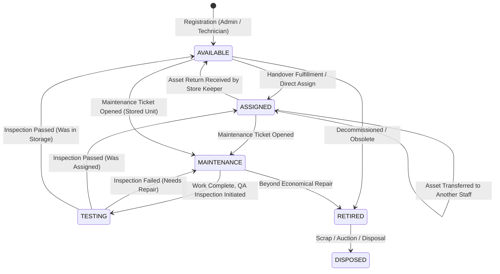
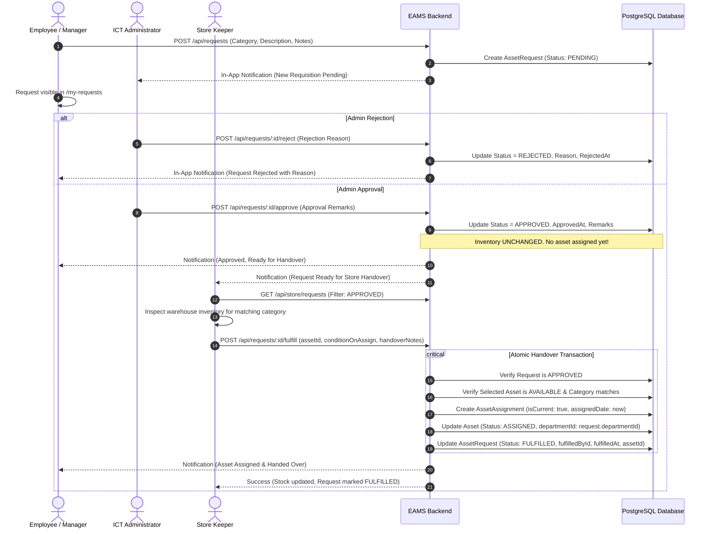
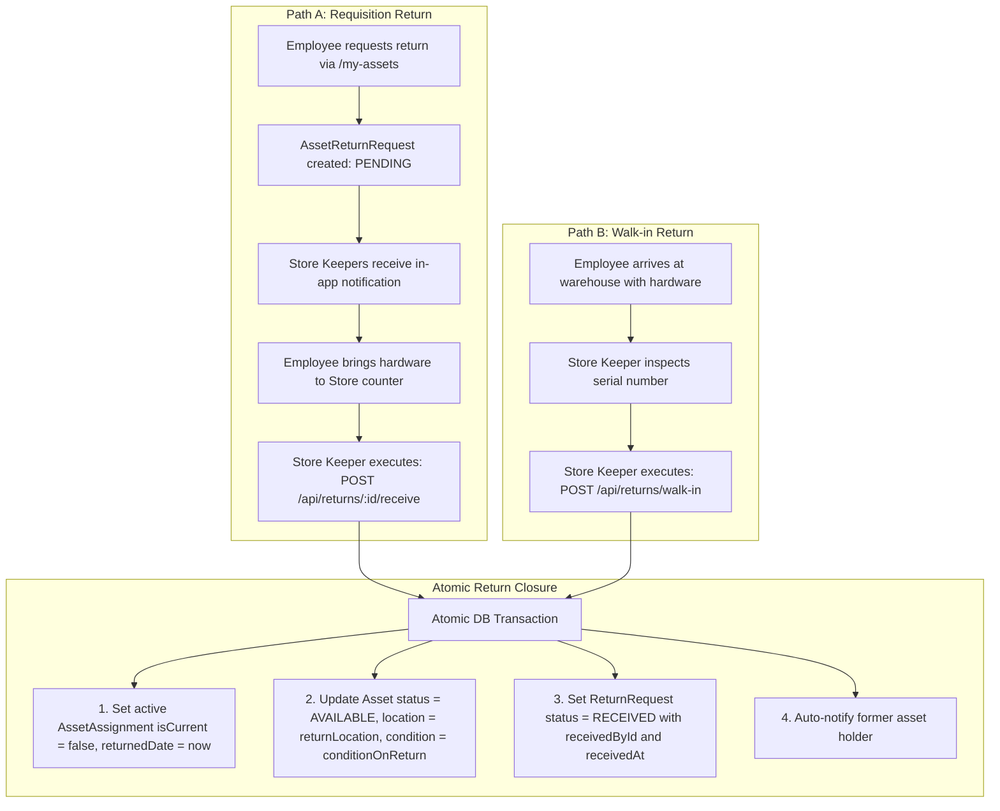
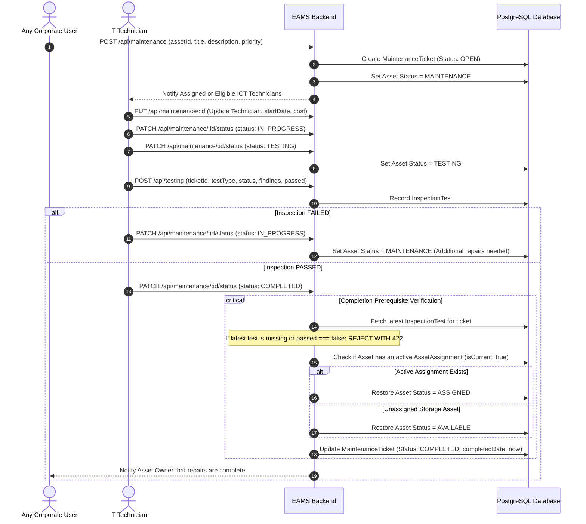

# 03. Business Workflows & Lifecycle Logic

## 1. Asset Lifecycle State Machine

An asset's lifecycle in the Ethiopian Engineering Corporation EAMS is governed by strict status transitions enforced across the database, service layer, and atomic transactions.



### Valid Asset Statuses (`AssetStatus` Enum):
- `AVAILABLE`: Stored in warehouse/depot, unassigned, ready for allocation.
- `ASSIGNED`: Formally issued to an active employee; in custody.
- `MAINTENANCE`: Under active technical inspection or physical repair.
- `TESTING`: Repair work completed; awaiting formal QA testing pass.
- `RETIRED`: Decommissioned from corporate service; pending scrap.
- `DISPOSED`: Permanently liquidated, auctioned, or destroyed.

---

## 2. Asset Requisition & Handover Workflow (Phase 11C)

The core requisition workflow guarantees that **financial and administrative approval** is separated from **physical warehouse inventory allocation**.



### Detailed Steps & Business Validations:
1. **Initiation (`POST /api/requests`)**:
   - Authorized roles: `EMPLOYEE`, `DEPARTMENT_MANAGER`, `IT_TECHNICIAN`, `ADMIN`.
   - Requires an active `EmployeeProfile`. Inactive employees receive `403 Forbidden`.
   - System assigns sequential code `REQ-YYYYMMDD-XXXX`.
   - In-app notification dispatched to all active `ADMIN` accounts.

2. **Administrative Approval (`POST /api/requests/:id/approve`)**:
   - Authorized role: Strictly `ADMIN`.
   - Request must currently be `PENDING`. If already approved, rejected, or fulfilled, returns `422 Unprocessable Entity`.
   - **Crucial Invariant**: Approving a request does NOT touch asset stock, does NOT select a serial number, and does NOT alter inventory counts.

3. **Rejection (`POST /api/requests/:id/reject`)**:
   - Authorized role: Strictly `ADMIN`.
   - Rejection reason is mandatory (minimum 3 characters).
   - Requester receives instant notification explaining rejection.

4. **Cancellation (`POST /api/requests/:id/cancel`)**:
   - Requester can cancel their own request only while still `PENDING`.
   - Once approved by Admin, the requester cannot cancel directly (they must coordinate with Store/Admin).

5. **Physical Handover Fulfillment (`POST /api/requests/:id/fulfill`)**:
   - Authorized roles: `STORE_KEEPER` and `ADMIN`.
   - Input payload: `{ assetId: string, conditionOnAssign?: string, handoverNotes?: string }`.
   - **Concurrency Guard**: If another technician assigns or reserves the asset concurrently, the transaction throws `409 Conflict: This asset is no longer available. Please select another asset.`
   - **Category Match Guard**: Validates that `asset.category === request.category`. If an Admin approved a Laptop request, the Store Keeper cannot fulfill it with a Monitor (`422 Unprocessable Entity`).

---

## 3. Asset Return Workflows (Phase 11D)

EAMS provides **two distinct paths** for returning assets back to corporate storage:
1. **Path A (Requisition Return)**: Initiated by an Employee or Department Manager when planning to surrender equipment.
2. **Path B (Walk-in Direct Return)**: Immediate physical return directly processed by the Store Keeper at the warehouse counter.



### Detailed Invariants for Asset Returns:
- **Eligible Status**: Only assets with `status === 'ASSIGNED'` and an active assignment (`isCurrent === true`) can be returned. Attempting to return an asset in storage or maintenance returns `422 Unprocessable Entity`.
- **Duplicate Prevention**: If an asset already has a pending return request (`ReturnRequestStatus.PENDING`), new requests for the same asset are blocked with `409 Conflict`.
- **Condition & Location Recording**: Store Keeper must record the physical condition of the hardware (`EXCELLENT`, `GOOD`, `FAIR`, `NEEDS_REPAIR`, `DAMAGED`) and the designated warehouse shelf/room location (`returnLocation`).

---

## 4. Maintenance & QA Testing Workflow (Phase 4 / 9D)



### Quality Assurance Invariant (Testing Prerequisite):
In `backend/src/modules/maintenance/maintenance.service.ts`:
```typescript
if (newStatus === 'COMPLETED') {
  const latestTest = ticket.inspectionTests?.[0];
  if (latestTest && !latestTest.passed) {
    throw new AppError('Cannot complete ticket: latest inspection test did not pass', 422);
  }
}
```
A maintenance ticket **cannot be completed** without a passing QA inspection test.

---

## 5. Direct Assignment & Transfer Workflows (`/api/assignments`)

Used by `ADMIN` and `IT_TECHNICIAN` for administrative allocations outside the requisition queue:

### 5.1 Direct Assignment (`POST /api/assignments/assign`)
- **Preconditions**: Asset must be strictly `AVAILABLE`. Employee must be `isActive === true`.
- **Actions in Transaction**:
  1. Creates `AssetAssignment` record (`isCurrent: true`, `assignedDate: now()`).
  2. Updates `Asset` status to `ASSIGNED` and sets `departmentId` to employee's department.
  3. Dispatches `NotificationType.SUCCESS` notification to employee.

### 5.2 Direct Transfer (`PATCH /api/assignments/transfer/:assetId`)
- **Preconditions**: Asset must be strictly `ASSIGNED`. New employee must be active and different from current holder.
- **Actions in Transaction**:
  1. Updates current assignment: `isCurrent = false`, `returnedDate = transferDate`, notes annotated with transfer recipient.
  2. Creates new assignment: `isCurrent = true`, `assignedDate = transferDate`.
  3. Updates `Asset.departmentId` to new employee's department.
  4. Dispatches in-app notifications to both the former holder and the new recipient.

---

## 6. Dynamic Inventory & Asset Movement History

### 6.1 Single Source of Truth Inventory
The inventory engine does **not maintain static quantity counter columns**. Instead, `getInventory()` executes grouped aggregation queries against the `Asset` table:
- **Status Counts**: `total`, `available`, `assigned`, `maintenance`, `testing`, `retired`.
- **Category Breakdown**: Aggregated by category with both enum key (`LAPTOP`) and human label (`Laptops`), detailing total, available, assigned, and under repair.
- **Location Breakdown**: Grouped by physical storage location (`Addis Ababa Kazanchis`, `Kality Central Lab`, etc.).

### 6.2 Asset Movement History (`/api/store/assets/:assetId/movement-history`)
Provides a unified, chronological ledger of an asset's entire life journey:
1. **Registration**: Initial entry with date, condition, and registering technician.
2. **Assignments & Handovers**: Every assignment event with requester, fulfilling store keeper, dates, and condition.
3. **Transfers**: Inter-departmental or staff-to-staff transfers.
4. **Returns**: Warehouse receiving events, return location, and check-in condition.
5. **Maintenance & Testing**: All repair tickets, technician notes, inspection test outcomes, and incurred repair costs.
